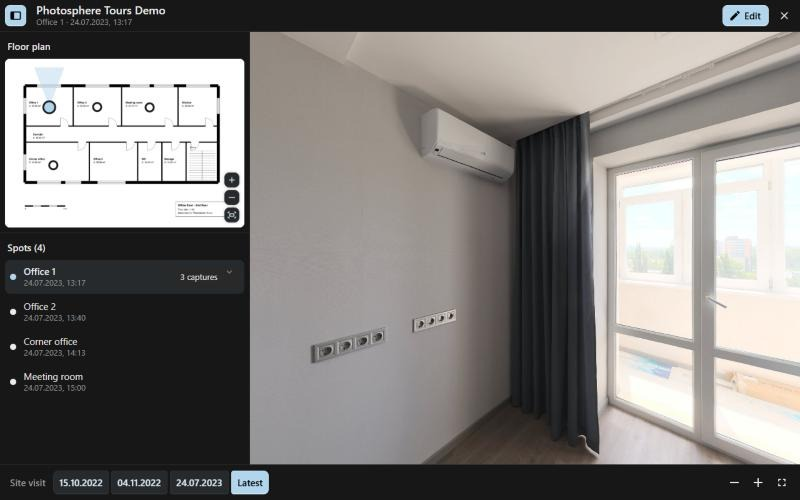
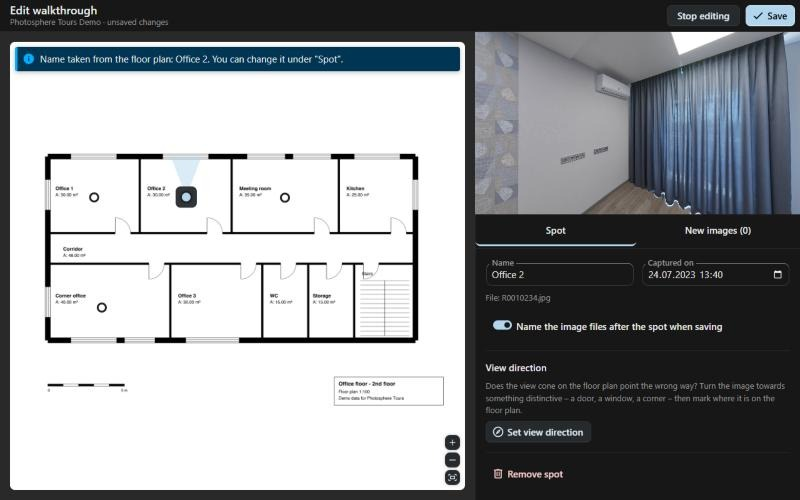
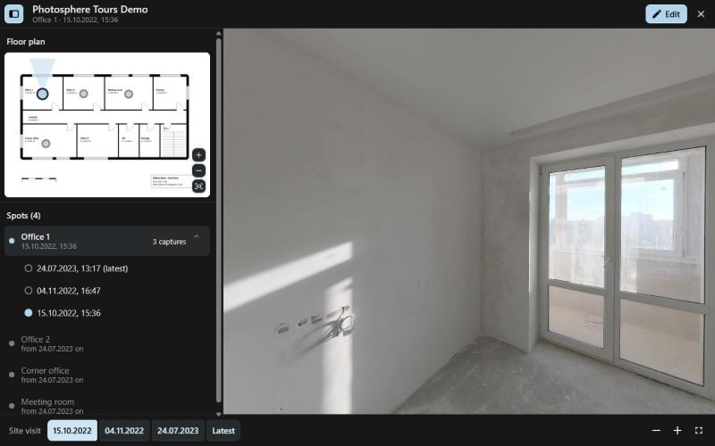
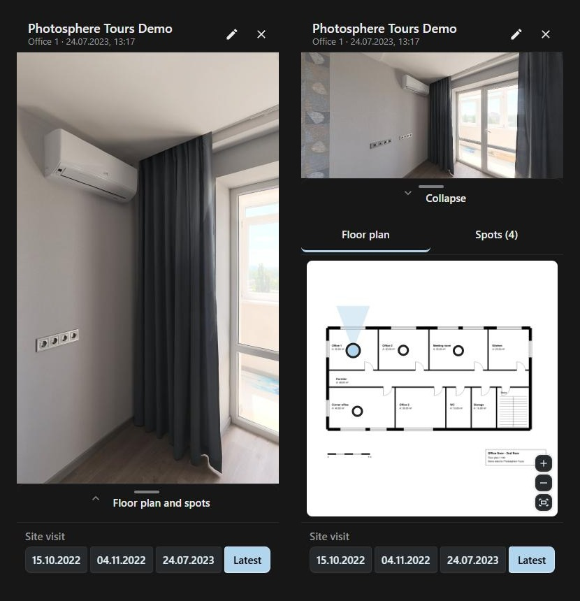

# Photosphere Tours

Turn a folder of 360° panoramas into a walkthrough on a floor plan, right inside
Nextcloud: see where each picture was taken and move from place to place – for a home,
an office, a venue, an exhibition or any other place you want to show or keep on
record. Built on [Photo Sphere Viewer](https://photo-sphere-viewer.js.org/).



## Features

### Create a walkthrough in a minute

- Put the 360° images and a floor plan (PDF, PNG, JPG, WebP or SVG) into a folder.
  A bar above the file list offers **Create 360° walkthrough**. A single plan in the
  folder is taken right away; a PDF is converted once.
- Pick an image and click its place on the plan. For PDF plans with text the room name
  from the plan is offered – take it over, correct it or give your own name. The
  capture date comes from the camera.
- Set the view direction once, so the cone on the plan shows where you are looking.
- Rename spots in the list – the image files can follow the new name.



### See how places change

Add later captures of the same spot. A **visit** shows only the spots captured on
that day; *All* shows every spot with its latest capture, and spots with several
captures let you pick one.



### Add text and photos with markers

A **marker** is a short text and/or a photo that belongs to a capture – a defect, a
detail, a remark for the next visit. Place it at a spot in the panorama, where it shows
as an icon you click to see the photo large, or leave it without a place: those photos
are one click away as *Photos at this spot*.

### Walk through it – on any device

Panorama next to the floor plan and the spot list. The plan zooms and pans, the side
bar can be resized or hidden, the dividers between plan and list and between panorama
and editing panel can be dragged, everything works with keyboard, mouse, touch and on
phones. Share the folder by link and guests see the walkthrough read-only.



### Your data stays plain files

Everything is stored in one file, `360-Rundgang.json`, next to the images – no
database, no server component. It syncs with the desktop client, moves with its
folder and is versioned like any other file. Removing a spot never deletes an image.

## Installation

Install **Photosphere Tours** from the
[Nextcloud App Store](https://apps.nextcloud.com/apps/photosphere_tours) under
*Apps → Multimedia*, or build the tarball with `make appstore` and unpack it into
`custom_apps/`. Requires Nextcloud 33 or 34 and a browser with WebGL 2. Languages:
English, German.

Fork of [files_photospheres](https://github.com/nextcloud/files_photospheres) by
Robin Windey, reduced to walkthroughs. Both apps can run side by side: single
panoramas keep opening in files_photospheres (or the Viewer app), this app only
reacts to walkthrough files.

## How it works

A walkthrough is one file, `360-Rundgang.json`, in a folder of panoramas – one
folder per floor, holding its floor plan and all its 360° images, whenever they were
taken.
Clicking it opens the panorama together with a side bar: the floor plan with all
spots and a list of the spots. Clicking a spot goes there, the view direction is
kept. *Visit* at the bottom shows only the spots captured on one day, with that
day's capture; under *All* spots with several captures show *n captures* in the
list and unfold to pick one. The floor
plan zooms (buttons, wheel, two fingers) and pans by dragging. The side bar can be
resized or hidden; on phones it is a bottom sheet. Markers of the shown capture appear
in the panorama as icons (camera with a photo, speech bubble without).

```json
{
  "version": 1,
  "title": "Ground floor",
  "plan": "Ground floor.png",
  "spots": [
    { "name": "Hall", "x": 0.41, "y": 0.29,
      "captures": [
        { "file": "2024-08-14_1602_Hall.jpg", "date": "2024-08-14T16:02", "yaw": 0 },
        { "file": "2025-09-24_1031_Hall.jpg", "date": "2025-09-24T10:31", "yaw": 12.5,
          "markers": [
            { "yaw": 83, "pitch": -12, "text": "Crack in the plaster", "file": "2D-Bilder/crack.jpg" },
            { "file": "2D-Bilder/overview.jpg" },
            { "yaw": 200.5, "pitch": 4, "text": "Check the cable duct" } ] } ] }
  ],
  "location": { "lat": 52.50156, "lon": 13.36347 }
}
```

- A later capture of the same place is one more entry in `captures`: in the editor,
  pick the image and click on the spot. The visits at the bottom are simply the days
  that have captures – nothing else to keep.
- `plan` and `file` are relative to the folder of the JSON file.
- `x`/`y` are normalised plan coordinates (0–1, origin top left).
- `yaw` (degrees) is the raw panorama direction that looks towards the top of the
  plan – per capture, since the camera is turned differently for every shot. It is set
  in the editor: pick the spot and its capture, then click on the plan beside it.
- `markers` (optional, per capture): a text and/or a photo. Files without it stay valid.
  Fields the app does not know (from a newer version or another tool) are kept when it
  saves, on every level. Versions up to 0.5 still rebuild the file from the fields they
  know, so saving with one of them drops `markers`, `location` and any other new field.
  - `yaw` (any number, normalised to 0–360) and `pitch` (−90–90) are the place in the
    panorama in degrees, **raw panorama coordinates** like the image itself, not the
    view aligned to the plan, so correcting a capture's view direction never moves its markers. Both are given or
    both are left out (a marker without a place).
  - `text` is plain text, up to 2000 characters, newlines allowed; the first line is
    the title. `file` is a photo, relative to the folder of the JSON file like every
    other path, by convention in the subfolder `2D-Bilder/`.
  - A marker needs a `text` or a `file`. As with other format errors, an invalid marker
    keeps the walkthrough from opening; the message names spot, capture and marker.
- `location` (optional): where the building is, WGS84 with 5 decimals (about 1 m). It
  belongs to the walkthrough, not to a spot. It is set from the GPS position of the
  first image placed in a walkthrough that has none; values outside the valid range
  and exactly 0/0 are ignored. There is no input field for it. An invalid `location`
  keeps the walkthrough from opening.

There is no database and no server-side code beyond loading the script: the file
syncs with the desktop client, moves with its folder and works through public
share links.

## Usage

- **Create:** put the 360° images and a floor plan (PDF, PNG, JPG, WebP or SVG) into
  one folder. A bar above the file list offers *Create 360° walkthrough* (also in the
  folder's menu: *Open as 360° walkthrough*, and under *New*). With one floor plan
  in the folder it is taken right away, otherwise you pick it. A PDF plan is turned
  into a PNG next to it. A plan picked from another folder is copied into this one
  first, so everything a walkthrough uses lies next to it. Only the folder itself
  counts – subfolders (for example compressed copies) are ignored.
- **Open:** the bar above the file list (*Open walkthrough*), the folder's menu, or a
  click on `360-Rundgang.json`.
- **Edit** (needs write permission): *Edit* opens the editor – floor plan on the
  left, panorama and one panel with the selected *Spot*, its *Markers*, the floor plan
  file and the *New images* on the right; drag the border between plan and column to
  share the width and the border between panorama and panel to share the height. On
  the plan, dragging pans, a short click on a spot selects it.
  *New images* lists images of the folder that belong to no spot yet; a picked image
  shows in the panorama at once – click on the plan for a new spot, or on a spot to
  add it as another capture. *New images* and *New photos* show the capture time under
  each preview, oldest first, so the images can be matched to the floor plan by the order
  of the walk-through. The time comes from the image's EXIF data, else from a date in the
  file name, else from the file (marked "≈"); the lists appear at once and re-sort as the
  EXIF dates are read in the background. With
  a PDF plan, the room name of the nearest room stamp is offered: *Use it* puts it into
  the name field, where it can still be corrected; *Use all suggestions* does it for
  every spot that still has the camera's file name. Nothing is renamed before that.
  Drag spots to move them (or use the arrow keys).
  *View direction*: with a spot selected, turn the panorama towards something you can
  find on the plan and click that place – the cone turns there (*Undo* in the note
  takes it back). Removing only drops images from the walkthrough, files
  are never deleted. The capture date comes from the camera's EXIF data, else
  from a date in the file name, else from the file time. When a newer floor plan appears in the folder the editor
  offers to switch; *Change floor plan* does it by hand.
- **Markers** (editor): the *Markers* section of the selected capture lists its markers
  with thumbnail, first line and *Placed* or *No place*; a click opens one for editing
  (text, *Choose photo* / *Other photo*, *Remove photo*, *Remove marker*).
  *Place marker* creates a marker where you click next; Esc cancels. *Place in the
  panorama* does the same for a marker without a place. A placed marker is moved by
  dragging its icon in the panorama (a short click opens it in the list, *Undo* in the
  note takes the move back). Placing and moving work with mouse or touch only; photos
  can also be added without the mouse. *Remove marker* has no confirmation: *Undo* in the
  note brings it back, and the image file is never deleted. A marker without text and
  photo is not saved. Photos live in the subfolder `2D-Bilder/` next to
  `360-Rundgang.json`; *New photos* lists those no marker uses yet, *Add to this
  capture* adds one as a marker without a place. *Choose photo* opens the file picker
  – a photo from elsewhere is copied into `2D-Bilder/`, never overwriting. On share
  pages there is no file picker, so *Choose photo* is hidden there.
- **Markers** (viewer): a click on a marker icon opens a dialog with the photo large and
  the text below; *Previous* / *Next* page through all markers of the capture. The
  button *Photos at this spot (n)* (or *n markers*) next to the zoom buttons opens the
  same dialog – it is also the way to every marker with keyboard and screen reader. A
  marker icon in the spot list shows that the shown capture has markers. A visit shows
  the markers of that day's capture.
- **Location:** with a known location the header has *Open in OpenStreetMap*, which
  opens openstreetmap.org in a new tab; share pages do not show it (the `location` stays
  in the file). No map is embedded and the app itself makes no external requests.
- **Dividers:** the borders between floor plan and spot list (side bar) and between
  panorama and panel (editor) are dragged with the mouse or moved with the arrow keys,
  like the column border. The sizes are remembered per browser. On phones the tabs stay.
- **Rename:** the pencil next to a spot in the list renames it and saves right away;
  the spot's image files are renamed too (`2024-08-14_1602_<name>.jpg`). In the
  editor this is a switch under *Spot*.
- **Keyboard:** Tab through header, plan, spot list and visits; arrow keys turn
  the focused panorama (+/− zoom) and move the focused spot in the editor; Escape
  leaves modes, then the editor, then the walkthrough.
- **Share:** share the folder by link. Guests see the walkthrough read-only.

## Development

```bash
npm ci
npm test          # vitest
npm run build     # webpack → js/
make appstore     # build/artifacts/appstore/photosphere_tours.tar.gz
```

Supported: Nextcloud 33 and 34, desktop and phone. Needs a browser with WebGL 2.

## Screenshots and demo data

The screenshots in `screenshots/` show a demo walkthrough: panoramas from
[Poly Haven](https://polyhaven.com) (CC0) and a floor plan drawn for the purpose.
`tools/demo/` recreates the data.

## License

AGPL-3.0-or-later, see [COPYING](COPYING). Bundled libraries and their licenses:
[THIRD-PARTY-NOTICES.md](THIRD-PARTY-NOTICES.md).
